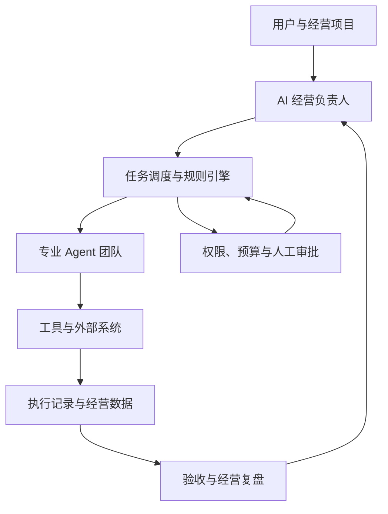

# 独立站 AI 创业与经营中台完整方案

**产品定位：用户提出想法、提供实际条件，由 AI 中台组织专业 Agent，完成机会探索、商品验证、独立站经营和持续优化。**

这份方案包含**总体蓝图＋四份相互对应的实施方案**：

1. **产品与业务方案**：用户怎么用，生意怎么推进。
2. **Agent 与系统实现规格**：员工怎样工作，中台怎样组织与控制。
3. **接口与数据方案**：如何真实执行、保存资料和获取经营反馈。
4. **开发与验收方案**：先做什么、后做什么、怎样证明完成。

**方案适用前提：**你没有商品、没有独立站运营经验，但能够建设站点。第一版面向单人或小团队，先支持一个目标市场、一种主要语言、一种独立站系统和一个主要获客渠道。

本文是完整的目标设计与开发基线。具体平台接口是否可用、现有代码可以复用多少，属于实施时必须核实的事项，不视为已经完成。

---

# 总体蓝图

## 1. 中台究竟负责什么

中台负责把下面这条链组织起来：

**用户想法 → 明确经营条件 → 探索机会 → 验证商品与供应 → 准备销售 → 获客与转化 → 履约与售后 → 经营复盘 → 下一轮执行。**

用户不用亲自拆任务、选择员工、安排交接，但必须完成只有经营者才能完成的事项，例如身份认证、实际付款、样品检查及重要经营决策。

| 责任主体 | 核心责任 |
|---|---|
| 用户 | 真实条件、经营主体、资源投入、关键决策及必要人工操作 |
| AI 经营负责人 | 明确目标、计划、派工、验收、协调、复盘 |
| 专业 Agent | 完成专业任务，提交成果和执行证据 |
| 系统程序 | 调度、计算、状态、权限、预算、防重复、日志与恢复 |
| 外部服务 | 实际交易、内容分发、广告、支付、运输等能力 |

## 2. 三阶段业务模型

| 阶段 | 要解决的问题 | 阶段结果 |
|---|---|---|
| **A：机会探索** | 什么生意适合当前用户验证？ | 经确认的机会方向 |
| **B：商品与经营验证** | 是否有可靠商品、供应和利润空间？ | 可以进入销售准备的商品方案 |
| **C：独立站经营** | 如何获客、成交、交付并持续改善？ | 真实经营记录及下一轮行动 |

任何阶段都允许返回调整、暂停或结束。

## 3. 系统结构

## 4. 四份方案的对应方式

所有需求使用同一编号，贯穿业务、Agent、数据和验收。

| 编号 | 业务模块 | 主责 Agent | 核心数据 | 验收重点 |
|---|---|---|---|---|
| B01 | 项目启动 | 经营负责人 | 项目、约束、授权 | 目标明确，不重复追问 |
| B02 | 机会探索 | 市场研究 | 来源、证据、机会 | 结论可追溯 |
| B03 | 商品验证 | 商品、采购 | 商品、供应、样品 | 条件真实可核实 |
| B04 | 财务与风险检查 | 财务、风险 | 成本、预算、风险 | 计算准确，缺口透明 |
| B05 | 销售准备 | 文案、设计、站点 | 素材、页面、发布 | 可购买且信息一致 |
| B06 | 获客执行 | 自然、社媒、广告 | 内容、活动、费用 | 动作真实发生 |
| B07 | 转化与服务 | 站点、客服 | 访问事件、会话 | 问题能处理和回流 |
| B08 | 订单履约 | 订单物流 | 订单、包裹、售后 | 不漏单、不重复 |
| B09 | 复盘优化 | 经营负责人、财务 | 指标、实验、决策 | 反馈能触发下一轮 |

---

# 第一份：产品与业务方案

## 1. 用户与产品边界

### 首批用户

- 没有商品，但有试做独立站的意愿。
- 没有系统运营经验，需要中台带着推进。
- 能够承担合理验证预算。
- 愿意完成样品、认证和资金等必要人工事项。

### 第一版支持范围

- 实物商品。
- 单一主要市场和语言。
- 单一成交站点。
- 少量关联商品。
- 自然或付费获客先跑通一条主线。
- 供应商代发或少量采购，以实际条件选择。

### 第一版暂不自动承接

高复杂度、多主体、多仓、多市场、多币种资金调拨，以及需要复杂专业许可却尚未核实条件的业务。

系统可以识别这些需求并记录，但不能假装已具备执行能力。

## 2. 用户入口

| 入口 | 系统首先做什么 |
|---|---|
| **带我从零开始** | 了解条件，开展机会探索 |
| **验证我的想法** | 判断假设，补充证据和经营测算 |
| **经营我的独立站** | 读取现状，诊断当前主要问题 |

用户先自由表达，再通过短对话补齐关键条件。

**必须了解的信息：**

- 可投入预算、最大可承受损失。
- 每周可投入时间。
- 所在地、可使用的经营主体。
- 已有供应、账号、技能和其他资源。
- 不愿经营的商品。
- 对市场、供货方式和风险的偏好。
- 当前站点状态。

无法回答的信息允许标记待确定，由系统给出解释或研究建议。

## 3. B01：项目启动

### 系统流程

1. 提取用户目标和条件。
2. 区分事实、偏好、假设和未知。
3. 只询问影响路线的关键问题。
4. 判断当前应进入哪个阶段。
5. 生成项目启动卡。
6. 用户确认目标、预算和权限。
7. 启动阶段任务。

### 项目启动卡

| 字段 | 内容 |
|---|---|
| 项目目标 | 当前要验证或实现什么 |
| 当前阶段 | 探索、验证、准备或经营 |
| 已知条件 | 用户资源及确认事实 |
| 未知事项 | 需要研究或人工补充 |
| 预算 | 工具、验证、营销等分项 |
| 自动权限 | 允许的工具和操作 |
| 人工事项 | 认证、样品、付款等 |
| 成功条件 | 本阶段如何验收 |
| 停止条件 | 什么情况下暂停 |
| 下一步 | 首批任务和预期产物 |

**点击开始意味着启动这张卡定义的任务范围。**

## 4. B02：机会探索

### 研究内容

- 目标客户、需求与使用场景。
- 同类商品和替代方案。
- 价格、卖点、配送和服务条件。
- 差异化空间。
- 潜在获客路径。
- 供应与履约复杂度。
- 用户条件是否适配。

### 交付

默认先给出少量候选方向，建议不超过三个，每个包含：

1. 卖给谁、解决什么问题。
2. 需求证据和来源。
3. 竞争及差异化。
4. 初步供应线索。
5. 成本与获客假设。
6. 风险与未知。
7. 下一步验证方法。

### 进入下一阶段的条件

方向有依据、符合用户条件，且用户确认愿意验证。

研究不足时继续补充；没有合适机会时允许得出“暂不建议投入”。

## 5. B03：商品与供应验证

### 验证流程

**商品候选 → 供应线索 → 条件确认 → 样品核验 → 履约测算 → 商品决策。**

| 项目 | 必须确认 |
|---|---|
| 商品 | 规格、材质、重量、尺寸、用途、限制 |
| 供应 | 主体、库存、起订量、报价、交期 |
| 质量 | 样品检查、已发现问题及处理 |
| 素材 | 图片、商标和内容的使用条件 |
| 发货 | 发货地、处理时间、配送和包装 |
| 售后 | 退货、补发、质量责任 |
| 备选 | 断货或供应变化时怎么办 |

### 人工交接

中台准备检查清单和材料，用户完成样品检查后上传结果。收到结果后，任务自动恢复。

**没有实物验证，不能将“质量可靠”标为已确认。**

## 6. B04：财务与风险检查

### 财务口径

统一将“销售”“到账”“贡献”“利润”分开。

> **订单净收入＝商品及运费收入－商家折扣－退款－不属于商家收入的代收款项。**

> **广告前贡献＝订单净收入－商品采购－包装及履约物流－交易费用－商家承担的相关税费－其他订单可变成本。**

> **营销后贡献＝广告前贡献－分配的获客费用。**

> **项目经营结果＝营销后贡献合计－项目固定及其他期间费用。**

预测阶段可以计入预计售后损失；实际核算时使用实际记录并明确估计项，避免重复扣除。

### 必须输出

- 单笔贡献与目标获客成本。
- 正常和保守情景。
- 测试预算和现金需求。
- 缺失成本及可能影响。
- 风险清单和证据缺口。

### 阶段闸口

供应、质量、利润或重要风险未达到要求，不进入正式销售。可以继续研究、调整商品，或开展明确说明尚未正式销售的兴趣验证。

## 7. B05：销售准备

你提供站点，中台负责：

- 整理商品、分类和页面。
- 制作品牌、文案与视觉。
- 核对支付、运费和配送。
- 准备客服知识与服务政策。
- 配置或提出数据追踪任务。
- 检查移动端、购物车、结账。
- 进行测试订单及必要的退款流程验证。

### 上线条件

页面信息正确、购买路径可用、订单可以接收、履约有安排、追踪经过验证、重大问题已处理。

## 8. B06：获客执行

### 三条增长线

| 类型 | 工作内容 |
|---|---|
| 自然搜索 | 搜索需求、商品及内容页面、持续更新 |
| 社媒与合作 | 内容、互动、达人、联盟和其他合作 |
| 付费推广 | 广告测试、监测、调整与暂停 |

架构支持三条线，项目根据资源选择主线。

### 每次营销任务必须有

目标人群、商品、诉求、素材、承接页、执行渠道、预算、追踪方法、观察条件和停止条件。

**禁止只下达“多发内容、提高销量”这类无法验收的任务。**

## 9. B07—B08：转化、服务与履约

### 转化排查

| 现象 | 优先排查 |
|---|---|
| 没有有效访问 | 发布、投放、追踪和渠道匹配 |
| 有访问但商品兴趣弱 | 人群、素材承诺和页面内容 |
| 看商品但不加购 | 商品、售价、信任、配送条件 |
| 加购不付款 | 结账、支付、运费和额外障碍 |
| 有订单但贡献差 | 获客、成本、退款及商品组合 |

这些只是排查方向，不能直接认定原因。

### 履约闭环

订单接收 → 检查 → 发货交接 → 物流跟踪 → 异常处理 → 交付或售后结束。

### 客户服务闭环

咨询识别 → 查证 → 回答或建工单 → 协同处理 → 回复客户 → 反馈回流。

## 10. B09：复盘与再次执行

每轮优化记录：

**问题、证据、假设、改动、责任 Agent、资源、观察条件、实际结果和最终决策。**

经营结果不够时区分：

- 执行失败。
- 数据不足。
- 假设未获支持。
- 经营模型不成立。

不同情况产生不同下一步，不能统一变成“再生成一版素材”。

## 11. 页面结构

| 页面 | 核心内容 |
|---|---|
| 经营首页 | 阶段、目标、经营表现、当前重点、待决策 |
| 项目工作台 | 流程、依赖、任务、卡点和历史 |
| AI 员工 | 岗位、已接通能力、任务、产物、工作记录 |
| 商品与供应 | 机会、商品、报价、样品、成本 |
| 营销与实验 | 素材、日历、活动、费用、实验 |
| 客户与订单 | 会话、履约、售后、反馈 |
| 知识与连接 | 资料、规则、授权、工具状态 |

---

# 第二份：Agent 与系统实现规格

## 1. Agent 的统一定义

每个 Agent 必须具备：

**岗位目标＋输入规范＋共享资料访问＋工具权限＋执行流程＋结构化输出＋验收＋异常处理＋复盘。**

模型负责分析和生成；程序负责状态、金额、权限、限制和操作一致性。

## 2. 统一任务协议

| 字段 | 说明 |
|---|---|
| `task_id / project_id` | 唯一标识及项目归属 |
| `agent_role / task_type` | 责任岗位和任务类型 |
| `objective` | 要解决的问题 |
| `input_refs` | 输入资料及版本引用 |
| `dependencies` | 前置任务或条件 |
| `constraints` | 事实、品牌、市场等约束 |
| `deliverables` | 交付结构和文件要求 |
| `acceptance_rules` | 验收规则 |
| `permission_scope` | 允许的工具及操作 |
| `budget_limit` | 金额、次数和时限 |
| `escalation_rules` | 转人工或升级条件 |

统一结果包含：

`状态、产物引用、证据引用、外部动作、检查结果、未知项、费用、失败原因、下一步建议`。

## 3. Agent 内部运行流程

1. 读取任务及最新资料。
2. 检查输入和权限。
3. 缺资料则请求补充或创建依赖。
4. 制定局部计划。
5. 选择并调用工具。
6. 保存返回结果和外部操作标识。
7. 校验结果。
8. 有限次修复或重试。
9. 提交成果与交接说明。
10. 等待验收或后续反馈。

## 4. 14个 Agent 的执行规格

### A01｜经营负责人 Agent

- **定位：**组织项目，对计划、推进和协调负责。
- **输入：**用户条件、项目状态、员工结果、经营反馈。
- **流程：**需求解析→缺口分类→阶段判断→计划→任务依赖→派工→验收→复盘→调整。
- **工具：**项目、任务、预算、审批、指标查询。
- **输出：**启动卡、计划、任务、决策和复盘。
- **验收：**目标清楚、任务有负责人和验收条件、卡点有处理。
- **升级：**重大方向、超预算、重要风险、相互冲突的关键结论。
- **优化：**减少无效任务和交接损失，不自行突破经营边界。

### A02｜市场与消费者研究 Agent

- **定位：**提供机会和需求证据。
- **输入：**研究问题、用户约束、允许的数据源。
- **流程：**拆问题→检索计划→收集→去重→交叉核实→提取需求→比较→建议验证。
- **工具：**检索、文档读取、证据库。
- **输出：**研究报告、机会卡、需求与竞争表。
- **验收：**重要结论有来源，样本与未知透明。
- **升级：**关键数据不可得、来源冲突、费用超过限制。
- **优化：**用真实咨询和订单反馈修正研究假设。

### A03｜选品与商品运营 Agent

- **定位：**形成商品和销售组合。
- **输入：**需求、供应、成本、样品和风险。
- **流程：**候选→初筛→发起核实→比较→商品主档→SKU与组合→提交决策→持续调整。
- **工具：**商品库、供应查询、成本测算。
- **输出：**选品卡、商品事实、SKU、主推和定价建议。
- **验收：**事实一致，规格明确，取舍有依据。
- **升级：**重要规格不明、利润不成立、风险未解除。
- **优化：**根据贡献、退货和缺货调整商品。

### A04｜采购与供应商管理 Agent

- **定位：**落实可核实的供货条件。
- **输入：**商品要求、数量、质量、预算。
- **流程：**采购需求→寻源→授权询价→规范报价→补问→样品→比较→供应跟踪。
- **工具：**供应商库、文档、已授权通信。
- **输出：**报价、样品记录、采购与备选方案。
- **验收：**关键条件有确认记录，报价有效期清楚。
- **升级：**付款、合同、样品异常、供应商身份疑问。
- **优化：**依据实际质量和交期更新评价。

### A05｜跨境合规与风险 Agent

- **定位：**识别风险、组织核查和专业复核。
- **输入：**市场、商品、材料、页面和经营方式。
- **流程：**核查清单→权威资料→映射要求→检查证据→分类→整改→复核。
- **工具：**权威资料检索、证明文件库。
- **输出：**风险、缺口、整改和专业复核材料。
- **验收：**说明来源、适用范围和不确定性。
- **升级：**准入、资质、侵权、税务等无法可靠判断的问题。
- **优化：**新市场、新商品及重要变化触发复核。
- **边界：**不替代持证专业服务。

### A06｜财务与经营分析 Agent

- **定位：**算账、对账、管投入。
- **输入：**订单、支付、采购、物流、广告等记录。
- **流程：**导入→标准化→去重→程序计算→对账→差异处理→分析→预警。
- **工具：**计算、费用、订单、结算查询。
- **输出：**成本、预算、贡献、现金和对账表。
- **验收：**计算可复核，估计与实际分开。
- **升级：**重要差异、现金不足、缺失成本。
- **优化：**实际数据更新预测，不重复扣成本。

### A07｜品牌与本地化文案 Agent

- **定位：**形成真实且适合市场的表达。
- **输入：**商品事实、需求、品牌和渠道。
- **流程：**价值主张→信息层级→文案→事实核查→本地化检查→提交→反馈修改。
- **工具：**商品库、品牌库、写作与语言检查。
- **输出：**品牌规范、页面及营销文案、术语表。
- **验收：**准确、清楚、承诺一致。
- **升级：**商品声称无证据、重要语言歧义。
- **优化：**用真实反馈验证诉求。

### A08｜电商视觉与视频设计 Agent

- **定位：**生产商品一致、品牌统一的视觉。
- **输入：**真实素材、商品事实、品牌、文案、规格。
- **流程：**素材检查→商品约束→整套策略→逐图方案→生成编辑排版→检查→修复→交付。
- **工具：**素材库、图像、视频、排版、质量检查。
- **输出：**方案、文件、版本、质量报告。
- **默认交付：**主图至少5张，详情至少10张，详情默认9∶16。
- **验收：**商品身份、文字、尺寸、权利与品牌要求通过。
- **升级：**素材不足、无法保持商品一致、修复次数用尽。
- **优化：**提出设计假设，发布后再验证效果。

### A09｜独立站运营与转化 Agent

- **定位：**管理站点经营和购买体验。
- **输入：**商品、素材、配置、访问和客户反馈。
- **流程：**读取现状→检查→改动方案→预览→校验→发布→核对→实验与回滚。
- **工具：**站点连接、检查、分析。
- **输出：**页面、发布、问题和实验记录。
- **验收：**内容一致、流程可用、操作可追溯。
- **升级：**技术故障、支付问题、重大交易条件变化。
- **优化：**按证据改善转化，不随意反复改站。

### A10｜SEO与内容增长 Agent

- **定位：**积累搜索需求带来的访问。
- **输入：**需求、商品、页面、搜索数据。
- **流程：**意图分组→页面映射→内容任务→质量检查→发布→观察→更新或合并。
- **工具：**搜索数据、内容和站点工具。
- **输出：**需求地图、内容计划、优化与报告。
- **验收：**内容有用、不重复、页面匹配需求。
- **升级：**技术问题、数据不足、重要内容风险。
- **优化：**看有效访问和经营反馈，不按文章数量评分。

### A11｜社媒、达人与联盟 Agent

- **定位：**通过社交内容与合作获得客户。
- **输入：**人群、商品、账号、素材和合作预算。
- **流程：**渠道计划→内容派工→审核发布→反馈→合作筛选→授权联系→执行跟踪→核对。
- **工具：**社媒连接、合作库、链接及优惠码追踪。
- **输出：**日历、发布、合作档案与效果。
- **验收：**动作真实，合作条件和费用可查。
- **升级：**对外承诺、寄样费用、合作纠纷。
- **优化：**调整内容与合作对象，关注实际质量。

### A12｜广告投放 Agent

- **定位：**在预算内验证付费增长。
- **输入：**贡献、预算、人群、素材、页面、追踪。
- **流程：**就绪检查→测试计划→审批→执行→状态确认→监测→暂停或调整→复盘。
- **工具：**广告连接、预算和分析。
- **输出：**测试卡、执行、消耗和效果记录。
- **验收：**投入受控，追踪可信，修改有记录。
- **升级：**超授权、账户异常、追踪故障。
- **优化：**逐轮验证，避免同时修改全部变量。

### A13｜订单与跨境物流 Agent

- **定位：**将订单可靠推进到交付。
- **输入：**订单、支付、SKU、库存、配送。
- **流程：**防重复接收→检查→异常复核→发货交接→单号→物流监测→异常→交付。
- **工具：**订单、库存、供应和物流连接。
- **输出：**发货任务、包裹、异常及费用。
- **验收：**不漏单、不重复、状态真实。
- **升级：**地址、疑似风险、缺货、高成本补发。
- **优化：**根据时效、破损和费用调整建议。

### A14｜客服与客户生命周期 Agent

- **定位：**解决问题，经营客户关系。
- **输入：**商品、订单、政策、客户和许可。
- **流程：**识别意图→检索查证→答复或升级→工单→跟踪→反馈→许可触达。
- **工具：**客服、知识库、订单、客户系统。
- **输出：**会话、工单、反馈和触达记录。
- **验收：**答复准确、问题闭环、许可有效。
- **升级：**赔偿、争议、敏感问题及未知事实。
- **优化：**更新知识，减少重复问题，不强行自动结单。

## 5. 调度与协作规则

- 员工可以申请协作，但由中台登记和分配任务。
- 前置资料未就绪，不启动正式下游执行。
- 不同 Agent 对关键事实冲突时，创建核实任务。
- 已批准计划修改时，保留版本并说明受影响任务。
- 外部等待不持续调用模型，通过事件或定时检查唤醒。
- 用户纠正资料后，关联任务标记是否需要重验。

## 6. 三类控制

| 类型 | 示例 |
|---|---|
| 可自动执行 | 读取授权数据、生成草稿、分析、自检、异常提醒 |
| 授权范围内执行 | 发布确认范围内容、标准答复、预算内测试 |
| 必须审批 | 新采购、超预算、重大调价、退款赔偿、改变经营方向 |

授权必须说明对象、动作、金额、期限和撤销方式。

---

# 第三份：接口与数据方案

## 1. 接入原则

**优先官方接口和服务商支持的连接方式。没有可靠接口时，采用人工交接或导入，不把不可用能力包装成自动化。**

| 系统 | 读取需求 | 写入或执行需求 |
|---|---|---|
| 独立站 | 商品、库存、订单、退款 | 页面、商品、订单相关授权操作 |
| 支付结算 | 收款、费用、退款、结算 | 资金动作单独授权 |
| 访问分析 | 来源、电商事件、实验结果 | 必要配置按权限处理 |
| 广告 | 活动、消耗、效果 | 创建、暂停、调整 |
| 社媒 | 发布状态、互动和表现 | 内容发布及授权互动 |
| 客服与邮件 | 会话、订阅、许可 | 答复、服务和触达 |
| 供应与库存 | 报价、库存、交期 | 询价、采购或发货交接 |
| 物流 | 单号、轨迹、费用 | 运单或配送任务 |
| 生成工具 | 生成任务和结果 | 图片、视频及文件生成 |
| 研究工具 | 合法可用资料 | 保存证据，不默认获取竞品私有数据 |

### 每个连接器必须登记

支持动作、权限范围、账号归属、频率限制、费用、更新时间、错误码、回调机制和人工替代方法。

连接状态分为：**未配置、待授权、可读取、可执行、部分可用、异常、已撤销。**

## 2. 统一工具调用流程

**校验项目及权限 → 检查预算 → 生成操作标识 → 执行 → 保存结果 → 确认外部状态 → 发布事件。**

写操作需要防重复标识。超时后先查询结果，不直接再次执行，避免重复发布或重复付款。

密钥保存在服务端安全配置中，不能进入提示词、用户页面或普通日志。

## 3. 核心数据对象

所有对象包含组织归属、创建时间、更新时间和必要的版本。

| 对象 | 核心字段 |
|---|---|
| 项目 | 用户、目标、阶段、状态、约束、预算 |
| 计划版本 | 项目、目标、任务结构、变更原因 |
| 任务与尝试 | Agent、输入、状态、费用、错误、结果 |
| 证据 | 来源、时间、内容、事实类型、适用范围 |
| 机会 | 市场、人群、需求、竞争、假设、决策 |
| 商品与SKU | 事实、变体、素材、状态、站点映射 |
| 供应商与报价 | 主体、条件、币种、有效期、核验 |
| 样品 | 商品、检查人、照片、结果、问题 |
| 风险 | 适用市场、等级、证据、责任人、处理 |
| 成本与预算 | 项目、分类、币种、估计或实际 |
| 素材与页面 | 文件、用途、版本、来源、发布状态 |
| 营销活动 | 渠道、商品、素材、预算、追踪标识 |
| 客户与许可 | 必要身份、渠道许可、偏好、退订 |
| 订单与明细 | 商品、收入、折扣、支付、退款 |
| 包裹与物流 | 订单、运单、轨迹、费用、异常 |
| 服务工单 | 客户、订单、问题、责任、处理 |
| 实验 | 假设、改动、观察条件、结果、决策 |
| 审批与操作日志 | 申请、授权、动作、对象、外部结果 |

## 4. 关键关联

- 一个项目有多个计划版本和任务。
- 一个任务有多次尝试，但只有明确的有效交付版本。
- 商品关联供应、成本、素材、页面、营销和订单。
- 营销活动关联渠道、素材和追踪标识。
- 订单关联支付、包裹、售后和费用。
- 实验关联具体改动、任务、指标及决策。

**不能只保存一段聊天记录，再让模型每次猜项目进度。**

## 5. 事件与唤醒机制

| 事件 | 后续动作 |
|---|---|
| 项目确认 | 启动阶段计划 |
| 任务验收通过 | 解锁依赖任务 |
| 样品结果提交 | 恢复商品验证 |
| 风险发现 | 暂停受影响任务并核查 |
| 内容发布成功 | 保存链接并开始追踪 |
| 订单创建 | 启动订单检查 |
| 支付确认 | 按规则进入履约 |
| 物流异常 | 创建工单并通知客服 |
| 预算阈值触发 | 提醒、暂停或申请审批 |
| 观察条件达到 | 启动实验或经营复盘 |
| 授权撤销 | 停止相应操作 |

采用事件记录、可靠队列和定时补查；允许重复收到事件，但业务动作不能重复发生。

## 6. 指标与归因口径

| 指标 | 口径要求 |
|---|---|
| 有效订单 | 明确是否支付、取消、测试及退款 |
| 转化率 | 分母、周期、来源和机器人过滤一致 |
| 客单价 | 使用明确的收入与订单口径 |
| 获客成本 | 费用及新客口径明确，不能与所有订单混用 |
| 广告回报 | 广告归因收入÷广告支出，单独标记归因来源 |
| 订单贡献 | 按统一成本口径计算 |
| 退款与售后 | 明确按订单数还是金额计算 |
| 履约表现 | 按承诺与实际时间比较 |

### 归因规则

- 店铺订单是订单数量基础。
- 支付与结算用于核对收款。
- 各广告平台归因分别展示，不能相加当总销售。
- 第一版使用一种明确的站内归因规则，同时展示无法归因部分。
- 数据不足时标记未知，不自动归为自然流量。
- 退货存在滞后，近期贡献标记为暂估。

## 7. 安全与隔离

- 用户、组织和项目数据隔离。
- Agent按任务读取最少必要信息。
- 客户隐私不默认进入研究和生成任务。
- 外部内容作为资料，不得修改系统权限。
- 敏感动作完整记录审批和结果。
- 支持导出、撤权、备份和恢复。
- 数据保留及删除期限按业务与适用要求配置。

---

# 第四份：开发与验收方案

## 1. 开发原则

**先验证一条真实业务链，再扩展执行面。14个岗位定义完整，能力逐项开放。**

不要求第一版全部自动化；要求自动、人工和未接通部分清楚，且能可靠衔接。

## 2. 实施阶段

| 阶段 | 交付 | 退出条件 |
|---|---|---|
| P0 现状审计 | 架构、代码、数据、工具能力清单 | 明确复用、修改、新增 |
| P1 运行底座 | 项目、任务、Agent、状态、队列、权限 | 能执行、等待、返工、恢复 |
| P2 机会与商品验证 | 研究、商品、供应、成本、风险 | 能形成可审阅商品方案 |
| P3 销售准备 | 文案、设计、站点和上线检查 | 实际站点可购买 |
| P4 首个获客渠道 | 真实发布或投放及数据回流 | 动作与反馈可核查 |
| P5 订单与服务 | 订单、物流、工单及对账 | 一笔订单全过程可追踪 |
| P6 复盘再执行 | 实验、决策及自动派工 | 完成一次反馈驱动循环 |
| P7 扩展 | 更多渠道和自动能力 | 保持控制与可靠性 |

不在尚未审计接口、代码和资源时承诺工期或成本。P0结束后，根据实际依赖编制排期。

## 3. 每个模块的交付包

开发不能只提交“已完成”，必须提交：

1. 修改与新增内容。
2. 数据结构及迁移。
3. 接口与权限说明。
4. 页面与状态说明。
5. 正常及异常测试结果。
6. 真实操作证据。
7. 已知限制。
8. 回滚与恢复方法。

## 4. 核心验收用例

| 编号 | 场景 | 通过要求 |
|---|---|---|
| T01 | 新手没有商品 | 能补齐条件并启动探索 |
| T02 | 资料不完整 | 标记缺失，不擅自补成事实 |
| T03 | 研究缺少证据 | 不通过或明确降级结论 |
| T04 | 商品成本未知 | 不输出确定利润 |
| T05 | 样品等待 | 任务挂起，提交结果后恢复 |
| T06 | Agent交付不合格 | 能返工并保留版本 |
| T07 | 发布接口超时 | 查询结果，不重复发布 |
| T08 | 重复订单事件 | 只产生一次有效履约 |
| T09 | 预算达到上限 | 阻止新增未授权支出 |
| T10 | 外部授权撤销 | 停止相关动作 |
| T11 | 服务重启 | 任务和审批状态不丢失 |
| T12 | 经营数据不足 | 不硬判优化有效 |
| T13 | 用户纠正商品事实 | 相关内容和任务收到更新 |
| T14 | 退款及费用回流 | 贡献重新核算且可追溯 |
| T15 | 人工接管 | 可暂停、处理并交回系统 |
| T16 | 跨用户访问 | 无法读取其他用户数据 |
| T17 | 优化无效 | 能保留结论、撤回或停止 |
| T18 | 完整闭环 | 真实反馈触发任务并执行 |

## 5. 三层验收证据

| 层次 | 能证明什么 |
|---|---|
| 程序与规则测试 | 计算、权限、状态、防重复等逻辑 |
| 受控集成测试 | Agent、工具、队列和页面协同 |
| 真实业务验证 | 实际发布、订单、费用、反馈及调整 |

模拟数据可以测试逻辑，**不能证明真实经营已接通**。

没有真实自然订单时，可以使用标记清楚的测试订单验证交易链；但不能据此宣称获客成功。

## 6. 第一版最终验收标准

### 产品层

- 新手能够理解当前阶段和下一步。
- 用户不用逐条给员工派工。
- 待决策事项有具体内容和影响。
- 资料、成果和卡点可查看。

### 系统层

- 任务持久化，支持等待、暂停、重试和恢复。
- 关键动作防重复。
- 权限和预算真实生效。
- 错误和缺失如实呈现。

### 业务层

- 至少形成一份有证据的商品验证方案。
- 至少接通一个真实站点和一种获客执行能力。
- 能取得并核对经营反馈。
- 能完成一次反馈驱动的调整。

### 诚实性要求

不把生成当发布，不把测试当成交，不把销售额当利润，不把模型判断当验证结果。

## 7. 运行与成本管理

费用分开记录：

| 类别 | 内容 |
|---|---|
| AI运行 | 文本、图像、视频和其他模型调用 |
| 数据工具 | 检索、分析、外部服务 |
| 系统 | 数据库、文件、队列、部署和监测 |
| 经营 | 样品、采购、物流、广告和合作 |

降低无效消耗的方式：

- 共享证据和产物，避免重复研究。
- 按任务难度选择模型。
- 规则和计算由程序执行。
- 等待外部事件时不持续推理。
- 每个任务设置次数及费用上限。
- 复盘在达到条件后触发，不默认所有员工每天写报告。

运行监测包括任务成功率、失败原因、队列积压、接口异常、费用异常和需要人工处理的事项；备份恢复必须实际演练。

---

# 最终实施口径

这套中台最终应形成三个可以独立验收、又能连续衔接的成果：

1. **找到值得验证的生意方向。**
2. **把商品、供应、成本和销售条件核实清楚。**
3. **让站点进入真实经营，并根据反馈持续执行和调整。**

**对你当前最重要的第一步，是按这套方案审计现有中台，把“已有能力”和“设计目标”分开，再先打通机会探索到商品验证的链路。** 之后接入站点、一个获客渠道和经营反馈，最终形成完整循环。